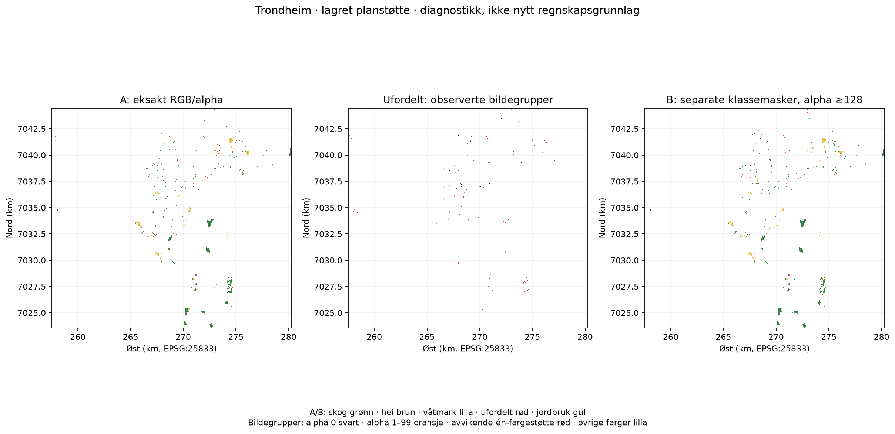
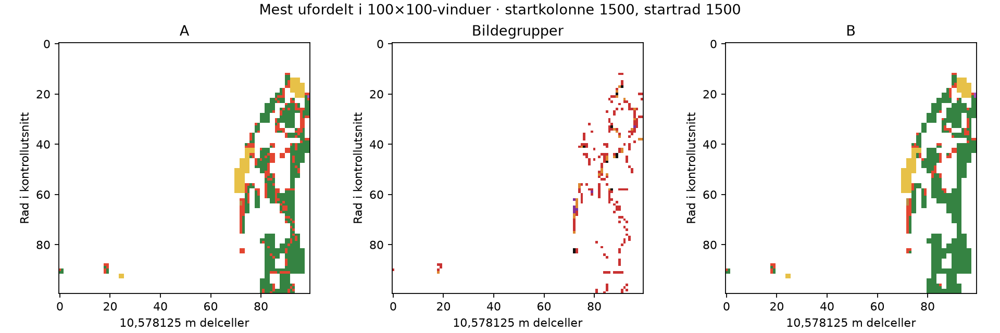

# Ufordelt natur i planområder – Trondheim

Undersøkt 14.10.2026 på faktisk lokal/remote HEAD
`b13670daf12b6b9ac276e1eb2200846912827c97`, branch
`feat/explore-analysis-map`, PR #76. Dette er undersøkelse og beslutningsstøtte.
Ingen produksjonsberegning, analyseidentitet, UI, kartlag eller publisering endres.
Tidligere [metodebeslutning](../decisions/2026-10-14-plan-land-cover-area.md)
og [kontrollrapport](2026-10-14-plan-area.md) beholdes som historikk.

## A. Kort konklusjon

**706,7074524100195 daa er ufordelt fordi detaljbildet ikke oppfyller
prototypens eksakte RGB-/alpha-regler innenfor den grove nivå-0-planstøtten.**
Dette er 6 319 av 24 936 naturdelceller, 25,34 %. Det er ikke dokumentasjon
for at en fjerdedel av naturen mangler økosystemklassifikasjon i Grunnkart.

To forhold er påvist: farge-/kantgjengivelse av allerede klassifiserte flater,
og geografisk konflikt mellom nivå-0-støtten og detaljbildets andre klasser.
Det er ingen påvist feil i flisplassering eller Canvas-skalering. Nye PNG8-kall
er byteidentiske med referansens sju fliser; observerte avvik mellom formatene
skyldes derfor ikke en påvist kildeoppdatering.

Vanlig PNG med samme SLD hjelper ikke: ufordelt øker til 709,95 daa.
Separate klassemasker kan i et kontrollforsøk redusere ufordelt til 445,23 daa,
men de løser ikke nivå-0-konflikten, og kildepunktene viser grenseavvik.
Resultatet er **ikke en validert ny klassifikasjon eller et nytt regnskapstall**.

Et bedre grunnlag finnes som dokumentert årsversjonert vektorprodukt med
økosystemattributter: GPKG/FGDB/GML via Geonorge. Faktisk Trondheim-fil,
fil-CRS, komplett skjema/topologi og bruksrett for denne prototypen er ikke
verifisert. Katalog-/nedlastingsvertene returnerer proxy-403 i kjøremiljøet;
offisielle metadata er lest med nettlesøk. Dette er en tilgangsbegrensning
i undersøkelsen, ikke bevis for at produktet mangler.

**Anbefaling:** neste avgrensede steg er et rettighetsavklart, låst
2025-polygonuttrekk for Trondheim og uavhengig geometrisk validering av
klasseverdier mot samme lagrede planmaske. Ikke innfør fargetoleranse eller
binærmaskeforsøket som produksjonsmetode nå.

## B. Dagens kjede og tallfestede årsaker

### Beregningskjeden

1. DiBK WMS, `kparealformalomrade`, eksisterende status-2-/formål-1000/2000-filter.
   Planbildet leses på nivå 9: 512×512 over 10 832 m, 21,15625 m celler.
   Alpha ≥128 gir planstøtte. Smale treff beholdes i denne masken.
2. Lokalt kommuneoversiktsraster `public/data/grunnkart/2025/overview/5001.png`,
   hentet 05.10.2026, 1802×2048, omtrent 19,72 m. Nivå 0 samples med floor ved
   planrutens sentrum. Alpha ≥100 og eksisterende nærmeste nivå-0-farge gir
   Natur/Jordbruk. Ingen separat eksakt kommunegrenseinterseksjon utføres.
   Denne eldre nærmeste-farge-regelen er også en metodisk begrensning;
   detaljklassifikatoren bruker derimot ingen nærmeste farge.
3. Naturparentcellene deles i fire 10,578125 m delceller. Jordbruk kopieres
   uten underfordeling. Detaljstøtten skaper dermed ikke en ny, eksakt
   naturgrense: alle fire delceller arver grovrutens nivå-0-klasse.
4. NIBIO `okosystemtype`, WMS 1.3.0/EPSG:25833, 1024×1024/samme flisutstrekning,
   `image/png; mode=8bit`, transparent. SLD filtrerer `okosystemtypeniva1`:
   `skog`=#ff0000, `heiBuskmark`=#00ff00, `liteVegetertMark`=#0000ff,
   `vatmark`=#ff00ff, `kyststrenderSvabergDyner`=#00ffff. Fyll uten stroke.
   Eksakt RGB og alpha ≥100 identifiserer type; alle andre naturdelceller får kode 6.
5. Areal = antall delceller ×10,578125² ×0,9994795815751638 /1000 daa.
   Arealfaktoren er eksisterende kommunevise UTM-tilnærming, ikke ny
   polygon-/pikselspesifikk geodetisk arealmetode.

Kildeverdiene i SLD er dokumenterte klasseattributter, og analytiske RGB-verdier
settes eksplisitt. Det brukes ikke kildens vanlige visningspalett. Likevel
gjør WMS-renderingen klasseattributtene til bildeverdier, med kantfarger,
transparens og palettkvantisering. Distinkte idealfarger kan derfor bli
avvikende eller blandede. RGB er ikke en klassekodekontrakt.

Masken er identisk med tidligere geografisk verdsatt-natur-analyse:
`c2282443c935dc02485b7bb380d4395147012f0d562f4b1c28f365534a15a46f`.
Alle pikselposisjoner og kategoriområder reproduseres med Pillow/NumPy og
uavhengig GEOS-radstripeunion. Ingen kategori eller celle er uteglemt.

### Fire gjensidig utelukkende observerte bildegrupper

Dette er en full oppdeling av referansens ufordelte areal. «Én-fargestøtte»
betyr samme mønster av null/positive RGB-kanaler som én idealfarge; det er
en beskrivelse av bildet, **ikke automatisk tildeling av kildeklasse**.

| Observerbar grunn til avvisning | Delceller | Daa | Hva kontrollen kan si |
| --- | ---: | ---: | --- |
| Helt transparent, alpha 0 | 921 | 103,003254 | Ingen malt natur i detaljpikselen; 909 har alpha ≥128 i masken for utelatte klasser |
| Alpha 1–99 | 1 618 | 180,954686 | Avvises av alpha-regelen; 1 551 har kontrolltreff for utelatte klasser |
| Alpha ≥100, avvikende RGB med én-fargestøtte | 3 683 | 411,901179 | Avvises av eksakt fargelikhet; forekommer også i vanlig RGBA-PNG, ikke bare PNG8 |
| Alpha ≥100, øvrige/blandede RGB | 97 | 10,848334 | Avvises av eksakt fargelikhet; blanding gir ingen entydig klassekode |
| **Sum** | **6 319** | **706,707452** | **Areal bevart, ingen ukjente fordelt forholdsmessig** |

Eksempel: `(253,0,0,229)` avvises selv om den ligger svært nær SLD-skogfargen.
`(127,0,0,2)` er både fargeavvik og svært svak alpha, og bokføres bare i
alpha-1–99-gruppen. Dette hindrer dobbelttelling av tekniske symptomer.

### Teknisk bildeproblem versus geografisk/datamessig konflikt

I tillegg ble hver av de fem naturklassene tegnet separat i hvitt, og de sju
andre registrerte nivå-1-verdiene samlet i en egen kontrollmaske. Det eliminerer
behovet for RGB-avstandsregler. Ved alpha ≥128, nøyaktig ett naturmasketreff
og ingen kontrollmasketreff blir oppdelingen av de opprinnelig 6 319 ukjente:

| Kontrollutfall, disjunkt | Delceller | Daa | Tolkning og begrensning |
| --- | ---: | ---: | --- |
| Én naturmaske og ingen utelatt-klassemaske | 2 373 | 265,392750 | Bildeavvisning kan reduseres i forsøket; dette er ikke dokumentert korrekt geodataareal |
| Utelatt-klassemaske har alpha ≥128 | 3 806 | 425,657313 | Nivå-0-støtten og detaljgjengivelsen er i konflikt; mulig grovsampling, renderingskant/overtegning eller kildeforskjell |
| Ingen av disse entydige utfallene | 140 | 15,657389 | Restusikkerhet ved grenser/overlapp/svake eller manglende masketreff |

Den eksakte siste arealverdien er 140×0,11183849539642658 =
15,657389355499722 daa. Oppdeling og krysstabell ligger i
[diagnosis.json](2026-10-14-unclassified-plan-nature/diagnosis.json).
De 2 373 forbedrede cellene består av 2 313 fra én-fargestøtte og 60 fra
blandede farger. Ingen helt transparent eller alpha-1–99-celle fylles inn.
35 tidligere identifiserte celler blir samtidig ukjente i B; netto reduksjon
er derfor 2 338 celler /261,47840223684526 daa.

**Dette tallfester observerte tekniske/geografiske kontrollutfall, ikke et
sikkert kausalt skille mellom «teknisk feil» og «reell mangel i Grunnkart».**
Et slikt skille krever direkte geometri/klasseverdier fra samme årsversjon.
Ikke kall de 425,66 daa datamangler eller feilklassifisert nivå 0 som en
fastslått fakta; også kantgjengivelsen kan gi slike treff. De 15,66 daa er
heller ikke påvist NoData. Ingen undersøkt kildepunkt har ukjent klasse.

### Kontroller som avgrenser forklaringene

- Alle sju PNG8-fliser hentet på nytt har samme SHA-256 som lagret referanse.
  Alle returnerte HTTP 200 og dekodet 1024×1024 PNG. Manglende/flisfeil
  forklarer **0** av referansens celler. Dette gjelder dette uttrekket.
- Rå PNG er palettbilder med alpha. Formatbytte til RGBA-PNG bevarer ikke
  alle kantverdier og gir 29 færre identifiserte delceller. Kvantisering alene
  er dermed ikke hovedløsningen; avvikende kanalverdier finnes før Canvas også
  i vanlig PNG. Antialiasing/alpha-/renderingsaritmetikk er en forklaring
  konsistent med bildene, uten at serverens interne trinn kan fordeles kausalt.
- Chromium 151 `createImageBitmap → drawImage` i samme størrelse →
  `getImageData`: RGBA endres for 147 949 piksler over alle sju fliser,
  derav 1 829 innen naturstøtten. Alpha endres for **0** piksler og
  produksjonsklassifikasjonen endres for **0** naturdelceller. Canvas-
  konvertering forklarer derfor ingen av de 6 319 avvisningene i dette uttrekket.
- Geografisk flisplassering/utsnitt/cellestørrelse matcher lagret produksjonsgrid
  og GEOS-kontrollen. Ingen målt forskyvning eller reskalering i denne kjeden.
  Nivå-0-midtpunktsampling og ulike oppløsninger er fortsatt reelle svakheter.
- Tolv nivå-1-verdier finnes i dagens offisielle kodeliste. Årsversjonens
  tegneregler viser elleve. `bukterKilerTidevannsonen` er den ekstra verdien.
  Natur-SLD-ens fem klasser er representert; de øvrige tegnes bevisst ikke.
  Ikke utvid Natur automatisk med vann/hav/grasmark eller ny marin klasse.
  Koblingen til prototypens nivå 0 må besluttes faglig.

## C. Faktisk undersøkte kilder

Offisielle nettsider og metadata ble kontrollert 14.10.2026. Metadataeksistens,
faktisk tjenestesvar og komplett nedlastet kommunegeometri holdes adskilt.

| Kandidat | Verifisert tilgang/innhold | Versjon, dekning, CRS/oppløsning | Bruksrett, begrensning og anvendelse |
| --- | --- | --- | --- |
| [NIBIO Grunnkart WMS](https://wms.nibio.no/cgi-bin/grunnkart_arealanalyse?service=WMS&version=1.3.0&request=GetCapabilities) | Faktiske PNG8/PNG/GetFeatureInfo-svar; `okosystemtype`, nivå 1, klasser som attributter i GML-info | Katalogen identifiserer samme endpoint som årsversjon 2025; capabilities sier ikke år. EPSG:25833 støttes; testgrid 10,578125 m, ikke opprinnelig kartnøyaktighet. MaxScale 50 000, MaxWidth/Height 5120 | Capabilities: ingen tilgangsbetingelser/gebyr. Katalog-API viser samtidig Norge digitalt-lisens. Metadataavvik må avklares før ny bruk/viderepublisering av avledede klasseprodukter. Prototypekilden gjenbrukes bare i isolert kontroll |
| [Årsversjonert vektorprodukt / offisiell metadata](https://data.norge.no/nb/datasets/ad38290e-2c12-3b77-96a8-fa07e02eefa7/nasjonalt-grunnkart-for-arealanalyse), [Geonorge UUID](https://kartkatalog.geonorge.no/metadata/uuid/28c28e3a-d88f-4a34-8c60-5efe6d56a44d) | GPKG, FGDB og GML er dokumentert tilgjengelig; fil ikke lastet ned i denne undersøkelsen | Årsversjon 2025, kilder oppdatert per 01.01.2025 ifølge metadata. Heldekkende fastlandsprodukt og én nautisk mil utenfor grunnlinjen ifølge NIBIO. Vektor: ingen fast pikseloppløsning; faktisk fil-CRS/nøyaktighet ikke verifisert | Norge digitalt-lisens. Ingen autentisert nedlasting konfigurert. Kan gi geometri + klasseverdier til interseksjon med lagret planstøtte etter tilgang-/rettighets- og CRS-kontroll |
| [Dokumentert Atom/GML-distribusjon](https://nedlasting.geonorge.no/geonorge/ATOM-feeds/GrunnkartArealanalyse_AtomFeedGML.xml), [nedlastings-API](https://nedlasting.geonorge.no/api/capabilities/) | URL-ene finnes i offisielle metadata. Proxy-403; Atom-oppføringer, filstørrelse og faktisk Trondheim-uttrekk ikke verifisert | Ikke anta at URL alene låser år eller tilbyr 25833. Det må kontrolleres i manifest/fil | Ikke åpent dokumentert som NLOD. Distribusjonen oppgir Norge digitalt-lisens; ikke et fritt tilgjengelig rasteralternativ |
| WFS på samme NIBIO-endpoint | Faktisk GetCapabilities gir HTTP 400, «WFS request not enabled» | Ingen featuretype eller årsversjon levert | Uegnet nå. MapServer er kompilert med WFS-støtte, men det beviser ikke at denne tjenesten tilbyr WFS |
| WCS på samme endpoint | Faktisk GetCapabilities gir HTTP 400, «WCS request not enabled» | Ingen coverage eller klasseverdier levert | Uegnet nå. Ingen annen offisiell Grunnkart-WCS funnet i undersøkte produktmetadata |
| `GetMap FORMAT=application/json` | HTTP 200; UTFGrid med 64×64 grid for 256×256 map, `keys`, **tomt `data`** | Feature-nøkler/interaksjonsgrid, ikke dokumenterte klasseverdier eller polygoner; ca. 15,625 m i testvinduet | Ikke GeoJSON. Gir ikke grunnlag for direkte klasse-/arealberegning |
| Nedlastbart klasseverdieraster, ArcGIS ImageServer eller tilsvarende | Ingen verifisert oppføring/endepunkt i undersøkte offisielle metadata/søk | Ikke verifisert; ingen testresultater konstruert | Ingen anbefaling basert på antatt tjeneste. WMS-TIFF/MVT som annonserte bilde-/renderingsformater er ikke i seg selv originale rasterverdier |

Supplerende autoritative kilder:

- [NIBIO produktbeskrivelse](https://www.nibio.no/tema/jord/arealressurser/andre-kart/grunnkart-for-arealregnskap):
  dekning, årsversjoner, inngående AR5/N50/FKB-vann/SR16/AR-FJELL/SSB-kilder;
  korrigering skal skje i opprinnelige kilder. Publisert 2025-årsversjon i mars 2026.
- [Offisiell GrunnkartFlate-datamodell](https://objektkatalog.geonorge.no/Objekttype/Index/EAID_B96B0139_3463_46a4_A65F_9023DABFA269):
  flategeometri, kommune, økosystemnivå 1/2/3 og kode, kildereferanser og identifikasjon.
  Dokumentert modell er ikke garanti for identiske fysiske GPKG-feltnavn.
- [Nivå-1-kodeliste](https://register.geonorge.no/sosi-kodelister/temadata/grunnkart-arealanalyse/okosystemtypeniva1),
  [2025-tegneregler](https://dokument.geonorge.no/tegneregler/nasjonalt-grunnkart-for-arealanalyse-%C3%A5rsversjon-2025/presentasjonsreglergrunnkartarealanalyse-2025.pdf).
- [Katalogens WMS-API og lisens](https://data.norge.no/en/data-services/a969f621-a85f-3188-99d1-93f7f71b1afa/nasjonalt-grunnkart-for-arealanalyse-wms-arsversjon-2025),
  [Norge digitalt-vilkår](https://www.kartverket.no/geodataarbeid/norge-digitalt/partsinformasjon/avtaler-og-vilkar/norge-digitalt-lisens).
  NIBIOs generelle NLOD-regel for nedlastinger uten passord kan ikke overstyre
  produktets spesifikke lisensmetadata.
- [MapServer UTFGrid-dokumentasjon](https://mapserver.github.io/output/utfgrid_output.html)
  forklarer forskjellen mellom feature-nøkler og eksponerte attributter.

Kildesvar, URL-er, SHA-er, størrelser og tider finnes i arkivet og
[requests.json](2026-10-14-unclassified-plan-nature/requests.json).
[download-probes.json](2026-10-14-unclassified-plan-nature/download-probes.json)
dokumenterer miljøets avvisning. Ingen tjeneste er erklært generelt utilgjengelig
bare fordi dette miljøet ikke kan nå den.

## D. Metodeforsøk og sammenligning

Alle forsøk bruker samme lagrede plan-/nivå-0-støtte, celler og arealfaktor.
Natur =2788,8047212052934 daa og Jordbruk =832,0784057494137 daa i alle rader.
Dette er en sammenligning av detaljfordeling, ikke en ny beregning av naturtotalen.

| Metode | Skog daa | Hei daa | Våtmark daa | Lite vegetert/kyst daa | Ufordelt daa | Avvik fra A |
| --- | ---: | ---: | ---: | ---: | ---: | --- |
| A, lagret PNG8/eksakt RGB/alpha ≥100 | 2032,217300 | 37,242219 | 12,637750 | 0 /0 | 706,707452 | Full referanse reprodusert |
| B1, vanlig PNG/samme regler | 2031,993623 | 34,222580 | 12,637750 | 0 /0 | 709,950769 | 29 identifiserte celler blir ukjente; ingen identifiserte typebytter |
| B2, separate klassemasker/alpha ≥128, eksklusiv tildeling | 2284,860461 | 42,163113 | 16,552097 | 0 /0 | 445,229050 | 2373 ukjente identifiseres, 35 identifiserte blir ukjente; ingen identifiserte typebytter |
| B2 følsomhet, alpha ≥100 | 2227,599151 | 39,702666 | 16,216582 | 0 /0 | 505,286322 | Flere maskekonflikter; ikke et mål på større faglig nøyaktighet |
| B2 følsomhet, alpha 255 | 2035,684293 | 35,340965 | 15,657389 | 0 /0 | 702,122074 | Netto bare 41 færre ukjente celler; full dekning løser lite |
| C, årsversjonert direkte geometri/klasseverdier | — | — | — | — | — | Ikke gjennomført: nødvendig fil/rettighet/årskobling ikke verifisert |

B2 er et dokumentert **følsomhets-/gjengivelsesforsøk**, ikke skjønnsmessig
nærmeste-farge-klassifikasjon. Det brukes aldri RGB-avstand, og ingen klasse
tildeles ved flere kvalifiserte naturmasker eller treff i utelatt-klassemasken.
24 opprinnelig ukjente celler har flere naturmasker med alpha ≥128. Alpha er
rendererens dekning/kompositering, ikke autoritativ polygonandel. Hele delcellen
bokføres fortsatt. Terskler endrer derfor metodebetydning, selv om arealsummen
bevares. Lavere ufordelt er ikke det samme som lavere feilrate.

### Grense-/attributtkontroll og begrensning av feilrate

115 unike punkter ble valgt deterministisk over sju fliser og strata:
eksakt, transparent, svak alpha, én-fargestøtte, blandet, forbedret og utelatt.
Samme punkt kan inngå i flere strata; strataradene skal ikke summeres som
uavhengige observasjoner. WMS GetFeatureInfo gir faktiske nivå-1/2/3-attributter,
kilde, ID og bounding box i EPSG:25833, men ingen polygongeometri.

| Kontrollstratum | Punkter | B2 tildelt klasse | Klasse finnes i infosvar | Avvik |
| --- | ---: | ---: | ---: | ---: |
| Tidligere eksakt klasse | 21 | 21 | 17 | 4 |
| B2 forbedret fra ukjent | 21 | 21 | 17 | 4 |
| Blandede/øvrige farger | 9 | 6 | 2 | 4 |
| Avvikende én-fargestøtte | 21 | 12 | 10 | 2 |

De observerte 4/21 avvikene i forbedringsstratumet er **19,05 % avvik mot
denne punktkontrollen**, ikke en estimert feilrate for Trondheim. Serverens
søketoleranse er ikke verifisert; pikseldekning og punktklasse er dessuten
ulike størrelser. Også A-klassifiserte punkter avviker 4/21. Kontrollen gir
dermed ikke grunnlag for å godkjenne B2 eller erklære A fasit. Den viser at
kjente klasser forekommer rundt grensene, og at direkte polygonkontroll trengs.
Ingen sann geografisk feilrate eller eksakt grenseforskyvning kan dokumenteres
fra bounding boxes alene. Dette er en eksplisitt uavklart gate, ikke en nullfeil.

For de 21 transparente kontrollpunktene returneres 17 bebygd, 3 dyrketmark
og 1 skog. Dette støtter nivå-0-/detaljkonflikten som forklaring, men utvalget
er ikke tilfeldig og brukes ikke til å ekstrapolere areal per kildeklasse.
[Alle kontrollpunkter og råsvar](2026-10-14-unclassified-plan-nature/sample-checks.json).

### Tid, kompleksitet og egnethet

| Kriterium | A | B1/B2 | C, foreslått men ikke testet |
| --- | --- | --- | --- |
| Korrekthet/fullstendighet | Konservativt bildeutvalg; grov arvet nivå 0 | B1 hjelper ikke; B2 reduserer avvisning, men grensekontroll uavklart | Attributtbasert klassifikasjon og geometri kan eliminere fargeavvisning; kildens egne feil består |
| Sporbarhet | Råbilder, masker, grid, hasher og metode lagret | Samme sporbarhet + flere maskesvar/terskelkontrakt | Årsmanifest, filhasher, skjema/kodelister, topologikontroll og kilde-ID |
| Kommune-/tidssammenligning | Kun Trondheim prepared; live WMS | Samme begrensning, renderer-/terskelavhengighet | Én nasjonal årskilde og versjonert preparation; krever harmoniserte kommunegrenser og metode |
| Tilgang | Eksisterende WMS, lisensmetadataavvik | Samme kilde og avvik | Norge digitalt-rettighet må avklares, inkludert offentlige avledede produkter |
| Nettverk/ytelse | 7 detaljkall, 1,16 MB | B1:7 kall/2,13 MB. B2:42 kall/4,62 MB med kontrollmasken | Filnedlasting/preparation ikke målt; kan gjenbrukes uten WMS-kall per analyse |
| Drift/vedlikehold | Live-kilde og nettleser-/palettavhengighet | Flere kall/cacher/terskler og større kildebelastning | Mer preparation/topologiarbeid, enklere versjonsbundet runtime; faktiske kostnader ikke målt |

Sum observerte individuelle HTTP-tider i samme uttrekk: A 5,73 s, B1 5,53 s,
B2 24,62 s. Dette er **summer av request-varighet**, ikke veggklokketid;
maks fire samtidige kall ble brukt. Offlineaudit av alle metodene, bildefiler,
avstandsdiagnostikk og kontrolloppsett tar ca. 4–5 s før figurtegning på dette
miljøet. Det er ikke produksjonsytelse eller en nasjonal benchmark. Ingen
beregningstid oppgis for C uten faktisk datatilgang.

## E. Geografisk kontroll

Kartet viser bare samme Natur/Jordbruk-støtte og klassifiserte delceller som
referansen. Hvitt utenfor støtte er ikke NoData i hele kommunen. EPSG:25833,
ingen bakgrunnskart eller ny appfunksjon. Full grid ligger i kontrollarkivet.

Detaljutsnittet velges automatisk som 100×100-vinduet med flest ukjente
delceller, ikke ved visuell utvelgelse av et gunstig eksempel.

- 4 969 av 6 319 ukjente (78,64 %) ligger maksimalt én detaljcelle fra
  en eksakt klassifisert WMS-piksel; 6 139 (97,15 %) innen to celler.
  Avstanden beregnes også til WMS-piksler utenfor planstøtten. Dette viser
  kantnærhet, men definerer ikke den sanne polygonkanten.
- 5 821 ukjente (92,12 %) ligger på eller innen én celle fra kanten av
  **valgt Natur/Jordbruk-støtte**. Denne kanten inkluderer nivå-0-naturgrenser,
  og er ikke en isolert måling av den juridiske plangrensen.
- Flisen øst 262160–272992 /nord 7031232–7042064 har 3 583 ukjente celler,
  400,72 daa /56,70 % av alt ufordelt. Østlig naboflis har 1 146 celler,
  128,17 daa. Ufordelt er altså konsentrert i støtte med mange små/kantnære
  treff, ikke jevnt fordelt over kommunens areal.
- Ingen ugrunnet kobling til en bestemt naturtype/landskap gjøres. Transparens
  kan gjelde bebyggelse/jordbruk utenfor detalj-SLD-en. Null identifisert kyst
  eller lite vegetert mark beviser fortsatt ikke at disse typene mangler.

## F. Konsekvenser ved et senere metodevalg

**Datagrunnlag:** last inn rettighetsavklart årsprodukt med alle kodeverdier,
geometri, kildereferanser og kommune-/årsmanifest. Kontroller faktisk CRS,
tom/ukjent klasse, gyldighet, hull/overlapp og dekning. Avklar eksplisitt
nivå-0-mapping av grasmark/vann/marine klasser. Ikke bruk prototypefarger
som offisiell koblingsnøkkel. Hold kildegrenser og versjonsdatoer adskilt.

**Beregningsmetode:** først C mot uendret lagret planstøtte for å isolere
klassifikasjonsforskjellen. Deretter en separat beslutning om eksakte
plan-/kommuneinterseksjoner, arealmetode og grovrutenett skal erstattes.
Ikke bland begge metodiske endringer i én differanseforklaring. Direkte
attributter krever en ny metode-/analyseidentitet og referansevalidering,
og kan endre både naturtotalen og underfordelingen når nivå 0 rekonstrueres.

**Kart:** eventuelle klassifiserte polygon-/rasterresultater og tall må
avledes fra samme nye analyseidentitet. WMS kan beholdes som kontekst;
forskjellen mellom kildegeometri og analyseresultat må fortsatt forklares.
Ingen kartmotor eller lag er endret i denne leveransen.

**Drift/forvaltning:** kommunevis eller nasjonal versjonert preparation,
spatialindeks og gjenbrukbare uttrekk. Stabile årsmanifester, råfilhash,
lisensregistrering, valideringslogg, metode-/kodelisteversjon og kvalitetsstatus
per kommune. Regnskapskritisk preparation kan ikke avhenge av tilfeldig
nettleser-/WMS-cache. Gjør pilot i flere kommuner med kyst, fjell, vann og
ulik AR5-dekning, og rekonsilier kommune-/nasjonalsummer før nasjonal utrulling.
Størrelse, ytelse og driftskostnad må måles på faktisk produkt; det finnes
ingen dokumentert nasjonal kostnadsberegning i dette forsøket.

Årsversjoner er kartbasetilstander. Kildene har ulik ajourholdsfrekvens.
Et årsversjonsbytte kan rette klassifikasjon/geometri uten fysisk naturtap.
Offisielle tidsserier krever særskilt endringsmetode, omklassifiseringsregler,
kommunegrenseharmonisering og faglig godkjenning; ikke differanser mellom
skiftende WMS-bilder eller automatisk fratrekk mellom årssummer.

## G. Konkret anbefaling og neste kontrollgate

**Velg direkte klasseattributter fra et låst 2025-vektoruttrekk som neste
valideringsmetode, og behold dagens produksjon fram til resultatene er vurdert.**

Forventet gevinst er at klasseidentifikasjon ikke lenger påvirkes av palett,
alpha, Canvas eller antialiasing, og at delcelle-/polygonkanter kan kontrolleres
mot faktisk geometri. Det er en metodisk kvalitetsforbedring, **ikke et løfte
om null ukjent eller om at 706,71 daa kan flyttes til skog**. Eksakt gevinst
og nye arealer må måles; B2 viser bare at bildeavvisning kan reduseres.

Neste pilot har avgrenset omfang: én kommune, én årsversjon, én lagret
planstøtte, direkte interseksjon per kildeklasse, uavhengig GEOS-kontroll
og dokumentasjon av alle A↔C-differanser. Kart-/UI-integrasjon og nasjonal
preparation er senere steg. Risikoen ligger særlig i rettigheter,
års-/nivå-0-kobling, topologi og endret semantikk ved grenseberegning.

Før implementering må NIBIO/Kartverket/dataforvalter avklare produktets
tilgang, offentlig bruksrett/avledet distribusjon, korrekt 2025-fil og
oppdateringskontrakt. Fagansvarlige må godkjenne nivå-0-bokføring,
areal-/grensemetode, NoData-/ukjent-regler, referansenivå og senere
tidsseriehåndtering. Ingen henvendelse er sendt som del av denne oppgaven.

## Reproduksjon og regresjonskontroll

Analyseverktøyene ligger separat i `apps/web/tests/analysis/`; ingen
produksjonsmodul importeres i Python og ingen nettleserside monteres i
Canvas-kontrollen. [Kjøringsanvisning](../../apps/web/tests/analysis/README.md).

- Lagret [referanseuttrekk](2026-10-14-plan-area/reference-inputs.zip) med
  [resultat](2026-10-14-plan-area/result.json) reproduserer Natur
  2788,8047212052934, Jordbruk 832,0784057494137 og ufordelt
  706,7074524100195 daa. Alle kodeposisjoner er identiske.
- [Forsøksuttrekk](2026-10-14-unclassified-plan-nature/experiment-inputs.zip)
  lagrer faktiske råsvar; dette gjør B sammenlignbart uten ny live-kilde.
- [Uavhengig GEOS-kontroll av verdsatte naturtyper](2026-10-14-unclassified-plan-nature/valued-geos-verification.json)
  gir 119,38040306544056 daa /70 lokaliteter; avvik mot JS er under
  0,00001 daa. Verdi-/typeunioner og lokalitetsarealer består.
- 178 frontendtester /32 filer, ESLint, TypeScript/Vite build og Ruff for
  analyseverktøyene består. Forsøksarkivet er pakket ut og kjørt på nytt;
  alle årsaks-, metode- og geografiske tall er identiske. Resultat registreres
  i [kontrollfilen](2026-10-14-unclassified-plan-nature/checks.json).
  Eksisterende Fast Refresh-/bundle-advarsler er uendret.

Main og publisert Pages-SHA `b13670daf12b6b9ac276e1eb2200846912827c97`
beholdes. Rapporten foreslår en senere beslutning, og innfører ingen ny metode.
