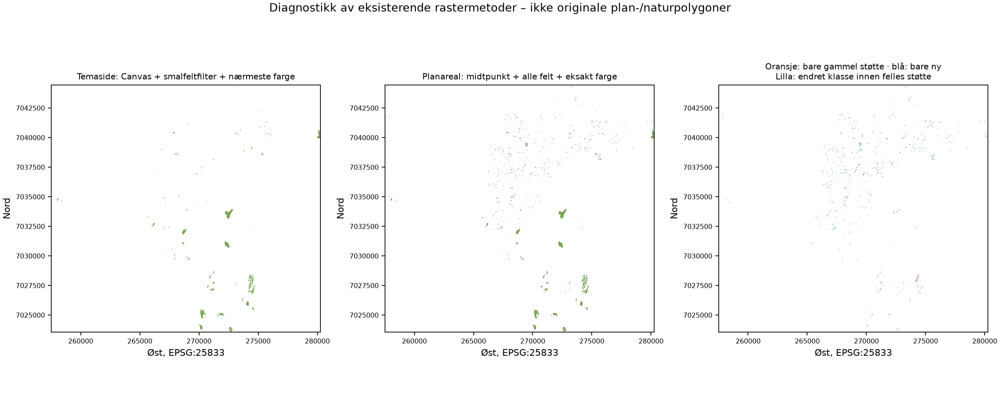
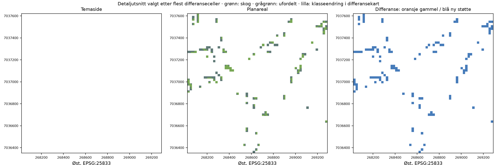

# Differanseanalyse av økosystemarealer i planområder

15.10.2026. Branch `feat/explore-analysis-map`, [PR #76](https://github.com/cwalso/Naturregnskap-V3/pull/76).
Oppfølging av [Issue #77](https://github.com/cwalso/Naturregnskap-V3/issues/77) og
[UX-kontrollens indikatorfunn](2026-10-15-user-journey-review.md).
Faktisk lokal og remote start-HEAD: `d934f143ecd8066792a239fcca5f1ec310b8cdde`.
Main: `a2e270dc7986cb2ce2f9a6c22ffe46e5aa7793db`.

## 1. Hovedkonklusjon

**Begge tallpar er reprodusert, og hele differansen kan forklares av tre
eksisterende metodeforskjeller:** resampling av nivå 0, fjerning av smale
sammenhengende felt og klassifisering fra detaljbildets farger.
Planfilter, detaljkilde, klassifikasjonsnivå, celleoppløsninger og arealfaktor
er felles. Samme spørsmål og klassenavn skjuler dermed **ulike faktiske
analyseavgrensninger og ulike regler for å tilordne en økosystemtype**.

Ingen særskilt implementeringsfeil er nødvendig for å forklare de observerte
tallene. Undersøkelsen påviser heller ikke en ny telle-, plasserings- eller
arealkorreksjonsfeil i disse uttrekkene. Dette betyr ikke at noen av metodene
er en geografisk fasit eller godkjent regnskapsmetode.

Den nye primæranalysen har best dokumentert **intern sammenheng mellom
spørsmål, bevart Natur/Jordbruk-støtte, synlig usikkerhet og kart/tall**.
Den anbefales videreført som den ene, tydelig avgrensede prototypeinngangen
for dette spørsmålet. Anbefalingen bygger ikke på nyhet eller antall desimaler.
**706,71 daa /25,34 % av naturarealet er fortsatt ufordelt**, og en nøyaktighets-
rangering mot faktisk naturgeometri er ikke mulig med dagens materiale.

Ingen produksjonskode, visning, kildeintegrasjon eller publiserte tall er endret.

## 2. Begge beregningsløp, fra kilde til vist tall

**Temaside:** `App.tsx` → `calculatePlannedDevelopment('5001')` →
`calculatePlannedNatureBreakdown(analysis)` → `plannedNatureBreakdown` →
`ForestPage` / `EcosystemPage` → km² ×1000 og avrunding til hele dekar.

`calculatePlannedDevelopment` henter det klargjorte nivå-0-bildet og DiBK-fliser.
Canvas skalerer et utsnitt av oversiktsbildet til hver 512×512-planflis.
Gyldige Natur-/Jordbruk-piksler krysses med planens alpha. Deretter kjøres
`removeNarrowPlanStrips` på denne masken. Naturtypetellingen skjer bare der
**den rensede** masken har Natur, med fire 10,578125 m delceller per hovedrute.
Alpha ≥100 gir tilordning til nærmeste av fem RGB-klassefarger; lavere alpha
blir uklassifisert. `App.tsx` viser resultatet bare når kommune og analyse-ID stemmer.

**Ny planarealanalyse:** `App.tsx` / `ExploreThemesWorkspace` →
`calculatePlanArea('5001')` → `loadFutureNatureMask` → `createPlanAreaGrid` →
`applyClassificationTile` → `summarizePlanArea` → `PlanAreaPanel` og Oversikt.

`loadFutureNatureMask` velger oversiktsbildets piksel ved hovedrutens midtpunkt,
krysser Natur/Jordbruk med samme DiBK-svar og **beholder smale felt**.
Hovedrutene deles i fire; bare Natur-delceller med eksakt detaljklassefarge
og alpha ≥100 får en av de fem naturtypene. Øvrige Natur-delceller beholdes
som ufordelt. Jordbruk forblir samlet. Resultatkartet bruker samme klassifiserte
delceller som tallene.

| Kontrollpunkt | Temaside | Planarealanalyse |
| --- | --- | --- |
| 1. Kilde og versjon | Samme klargjorte `5001.png`, 2025-prototype, hentet 05.10.2026; samme NIBIO-WMS for detalj | Identisk oversiktsfil og detalj-WMS. Sju rå detaljflishasher er identiske med referansen fra 14.10 |
| 2. Planavgrensning/filter | DiBK `kparealformalomrade`, `arealbruksstatus=2`, `arealformål LIKE 1* OR 2*`; plan-alpha ≥128; deretter separat smalfeltfilter | Samme URL-bygger, WMS-svar, filter og alpha; uten smalfeltfilter. Ingen særskilt plan-ID-/kommuneattributtfilter |
| 3. Økosystemdefinisjon | Skog=`skog`, våtmark=`vatmark`, blant fem landbaserte naturtyper | Samme navn og kildeverdier. Forskjellen skyldes ikke skogsidens separate **arealdekke**-hovedtall |
| 4. Klassifikasjonsnivå/kobling | Nivå 0: Bebygd / Jordbruk / Natur / vannklasser. Naturdetalj: `okosystemtypeniva1`; nærmeste farge blant fem naturtyper | Samme nivå-0-kobling: dyrketmark + grasmark er Jordbruk, fem naturtyper er Natur. Eksakt detaljfarge kreves; ingen ekstra økosystemklasse |
| 5. Raster/geometri | Oversikt 1802×2048, ca.19,72 m → Canvas-utsnitt med standard bildeutjevning → 21,15625 m planruter. Detalj 1024×1024 per samme flis-bbox: 10,578125 m | Samme kilde-/målgrid og detaljoppløsning. Nivå 0 velges med `floor` ved planrutens midtpunkt. Ingen ny planrasterisering ved deling i 2×2 |
| 6. Areal/avrunding | Delcelletelling ×10,578125² ×0,9994795815751638 /1 000 000 km²; ×1000 til daa; hele dekar i UI | Samme arealfaktor/cellestørrelse; direkte daa med opptil to desimaler. Ingen slope-/høydemodell; faktoren korrigerer UTM-projeksjonsskala |
| 7. Uklassifisert/feil | Alpha <100 blir uklassifisert; alle andre RGB-verdier presses til nærmeste av fem farger. Uklassifisert finnes i resultatmodellen, men ikke som eget nøkkeltall ved temakortet. Kildekall som feiler gir feil | Lav alpha og ikke-eksakt RGB blir ufordelt Natur. Ved detaljtjenestefeil trekkes alle naturtypetall tilbake; Natur/Jordbruk-totaler beholdes med feilstatus. Ingen forholdsmessig fordeling |
| 8. Kommune/grenser | Eier 5001 og rasterets gyldige dekning. Kommunegrense brukes til arealfaktor; ingen separat eksakt plan×kommune-vektorinterseksjon | Samme eier og prinsipielle begrensning. Ingen forskjell i tiltenkt kommune, men sampling/filter endrer hvilke celler som brukes |
| 9. Cache/identitet | `plannedDevelopmentCache`: kommunenummer; naturfordeling: kommune + `planned:5001`. Ingen råkildehash i denne ID-en; minnecacher innen sesjonen | Fullført/pågående resultat per kommune; fullført begrenset til 16. Egen `planned-land-cover-area-v1`-ID med kommune, foreldre-/klassifikasjonshash. Ingen tidsbasert invalidering av fullført kommuneresultat |
| 10. Tidsgrunnlag | 2025-merket oversiktsbilde + løpende plan-/detalj-WMS. Ingen historisk analyseperiode | Samme blanding. `WMS version=1.3.0` er protokollversjon, ikke årslås. Ingen `TIME` eller låst planversjon; ikke en analyse av 2017–2024 |

Felles råbildecache dedupliserer identiske pågående URL-kall og begrenser
nettverk per kilde til fire kall. Resultatcache innebærer likevel ikke at
kildene er årsversjonert. Reproduksjonen brukte en ny nettleser med kalde
resultatcacher og felles uendrede svar for begge løp.

Relevante produksjonsfiler, kun lest:
[plannedDevelopment.ts](../../apps/web/src/map/plannedDevelopment.ts),
[accountOverviewRaster.ts](../../apps/web/src/map/accountOverviewRaster.ts),
[analysisMask.ts](../../apps/web/src/features/future-analysis/analysisMask.ts),
[futureDevelopmentDisplay.ts](../../apps/web/src/map/futureDevelopmentDisplay.ts),
[plan-area/source.ts](../../apps/web/src/features/plan-area/source.ts),
[plan-area/model.ts](../../apps/web/src/features/plan-area/model.ts),
[utmArea.ts](../../apps/web/src/map/utmArea.ts),
[App.tsx](../../apps/web/src/app/App.tsx),
[ForestPage.tsx](../../apps/web/src/pages/ForestPage.tsx) og
[EcosystemPage.tsx](../../apps/web/src/pages/EcosystemPage.tsx).

## 3. Reproduserte arealtall og verifikasjon

Direkte kjøring av eksisterende funksjoner i Chromium 151 mot start-HEAD,
15.10.2026, ga:

| Størrelse | Temasideløp, daa før UI-avrunding | Planarealanalyse, daa | Ny minus eldre, daa |
| --- | ---: | ---: | ---: |
| Skog | 1815,586134 | 2032,217300 | +216,631166 |
| Våtmark | 16,775774 | 12,637750 | −4,138024 |
| Natur samlet i hvert løp | 1923,622121 | 2788,804721 | +865,182600 |
| Hei og buskmark | 43,617013 | 37,242219 | −6,374794 |
| Uklassifisert/ufordelt natur | 47,643199 | 706,707452 | +659,064253 |
| Jordbruk | 777,948574 | 832,078406 | +54,129832 |

UI viser dermed nøyaktig de etterspurte **1816/2032,22** og **17/12,64**.
Differansen mellom de avrundede UI-tallene er ikke den uavrundede differansen.
Desimalene i kontrolltabellen dokumenterer telling, ikke geodataenes nøyaktighet.

Kontrollgrunnlaget inneholder 20 faktiske plan-PNG-er, sju faktiske detalj-PNG-er,
tre Kartverket-svar, Canvas-resamplede nivå-0-piksler og begge løps mellommasker.
Hooks i isolert Vite-kjøring kopierer bare mellomresultater; ingen algoritme,
forespørselsparameter eller kilde erstattes. Alle 30 råsvar er SHA-256-kontrollert.

En **uavhengig offline Python-kontroll uten import av produksjonsklassifikatorer**
reproduserer nivå-0-oppslag, midtpunktsampling, smalfeltregel, RGB-klassifisering,
alle kategoriantall og geografiske celleposisjoner. Den eldre resamplingen
kontrolleres fra de faktisk lagrede Chromium/Canvas-pikslene; vi hevder ikke at
en annen renderer uavhengig har produsert byteidentisk resampling.

Alle celler i eldre rå/renset maske, eldre binære analysemaske, ny foreldremaske
og ny detaljmaske er identiske med de respektive JS-resultatene. Ingen
rest-differanse gjenstår i tallene under disse forutsetningene.

Ny foreldremaske, klassifikasjonsmaske, alle sju rå detaljflishasher og analyse-ID
er også identiske med den lagrede referansen fra 14.10.2026, ikke bare med nye
live-summer. Foreldrehash:
`c2282443c935dc02485b7bb380d4395147012f0d562f4b1c28f365534a15a46f`.
Dette beviser stabilitet for de undersøkte uttakene, ikke en evig låst WMS-kilde.

[Resultater](2026-10-15-ecosystem-overlap-differences/results.json),
[uavhengig kontroll](2026-10-15-ecosystem-overlap-differences/audit.json),
[referansesammenligning](2026-10-15-ecosystem-overlap-differences/reference-check.json),
[komplett kontrolluttrekk](2026-10-15-ecosystem-overlap-differences/captured-inputs.zip).

## 4. Dokumenterte årsaker, med målbare bidrag

Tabellen endrer én eksisterende regel om gangen. Mellomradene er isolerte
diagnostiske kombinasjoner, **ikke nye godkjente analyser eller korrigerte tall**.

| Løp / kontrollkombinasjon | Natur daa | Skog daa | Våtmark daa | Ufordelt daa |
| --- | ---: | ---: | ---: | ---: |
| Eldre: Canvas + smalfeltfilter + nærmeste farge | 1923,622121 | 1815,586134 | 16,775774 | 47,643199 |
| Behold Canvas/nærmeste farge, ta med feltene før smalfeltfilter | 2808,935650 | 2530,234120 | 17,223128 | 213,723365 |
| Bytt bare til midtpunktsampling, fortsatt uten smalfeltfilter/nærmeste farge | 2788,804721 | 2442,888255 | 16,887613 | 283,957940 |
| Ny: samme støtte, eksakt farge | 2788,804721 | 2032,217300 | 12,637750 | 706,707452 |

For skog: **+714,647986 −87,345865 −410,670955 = +216,631166 daa**.
For våtmark: **+0,447354 −0,335515 −4,249863 = −4,138024 daa**.
Tilordningen av bidrag avhenger av rekkefølgen: filtrering og sampling påvirker
hvilke celler fargeregelen brukes på. Alle åtte kombinasjoner av de tre valgene
ligger i kontroll-JSON-en; tabellen er en etterprøvbar dekomponering, ikke
universelle feilkoeffisienter.

### Smalfeltfilteret endrer selve støttearealet

`removeNarrowPlanStrips` er **ikke** et jevnt kantfratrekk eller en fast
minstearealregel. En celle er startpunkt hvis den har valgte celler i alle fire
ortogonale retninger. Derfra beholdes hele den åtte-sammenhengende komponenten,
også dens smale armer. Komponenter uten slikt startpunkt fjernes helt.
Natur/Jordbruk behandles sammen i denne regelen, ikke én økosystemtype om gangen.

I Canvas-grunnlaget finnes 905 komponenter, hvorav 826 fjernes. De inneholder
1979 Natur-hovedceller, **885,313530 daa**, og 142 Jordbruk-hovedceller,
**63,524265 daa**. Eldre natur går fra 6279 til 4300 hovedceller. Den nye
midtpunktsmasken har 6234 Natur-hovedceller og 1860 Jordbruk-hovedceller.
Det er derfor galt å tolke forskjellen som kun finere detaljklassifisering.

### Resampling endrer klasse/alpha langs grensene

Samme oversiktsfil og samme 21,15625 m målgrid gir ikke identiske klasser når
Canvas-interpolasjon sammenlignes med ett kildepiksel ved rutemidtpunktet.
Med smalfeltfilteret ute reduseres naturtotalen 20,130929 daa ved dette byttet;
skog reduseres 87,345865 daa. Klasse-/alphaendringer både legger til og tar ut
celler. Ingen global feilforskyvning eller endret flis-bbox er funnet.

### Nærmeste farge kontra eksakt farge

Det eldre løpet har ingen maksimal tillatt RGB-avstand: hver detaljpiksel med
alpha≥100 tilordnes en av fem naturtyper. Det nye løpet krever eksakt RGB.
På den samme nye støtten blir 3780 delceller med alpha≥100 derfor **ufordelt**
i det nye løpet, i stedet for typer via nærmeste farge:422,749513 daa totalt,
derav 410,670955 daa som ellers ble kalt skog og 4,249863 daa våtmark.

De 6319 nye ufordelte delcellene består av 921 helt transparente, 1618 med
alpha 1–99 og 3780 med alpha≥100/ikke-eksakt farge. Lavere ufordelt i det eldre
løpet er derfor ikke bevis for bedre dekning eller større korrekthet.

**Ikke påvist som årsak i denne reproduksjonen:** andre kildeklasser,
endrede planfiltre, annen detaljoppløsning, ulik arealfaktor, ulik kommune,
årsendring eller stale resultatcache. Årsversjon/løpende WMS er fortsatt en
generell usikkerhet, men behøves ikke som hypotese for å forklare disse tallene.

## 5. Geografiske forskjeller

Begge resultater er lagt på **samme 10,578125 m grid i EPSG:25833**.
Grønn er skog, beige hei/buskmark, lilla våtmark og grågrønn ufordelt i
metodekartene; hvitt er utenfor den respektive Natur-støtten. Differansekartet
skiller gammel-only støtte (oransje), ny-only støtte (blå) og klasseendring
innen felles støtte (lilla). Dette er rasterresultater, ikke originalgeometrier.

- 600 delceller /67,103097 daa finnes bare i gammel Natur-støtte.
- 8336 delceller /932,285698 daa finnes bare i ny Natur-støtte.
- 1659 delceller /185,540064 daa endrer klasse innen felles støtte; alle går
  fra en navngitt klasse til ufordelt, ikke fra én kjent naturtype til en annen.
- Totalt endrer 10595 delceller /1184,928859 daa tilstand. Dette er geografisk
  endringsflate mellom metodene, **ikke netto arealtillegg, naturtap eller sann feilflate**.
- 7898 av 10595 endrede celler, **74,54 %**, ligger på eller innen én detaljcelle
  fra kanten av det lagrede binære DiBK-planrasteret. Dette er rasterkantnærhet,
  ikke dokumentert avstand til juridiske planpolygoner. Resten kan blant annet
  gjelde nivå-0-/klassekanter og fjernede smale komponenter.

Detaljutsnittet er det 120×120-vinduet med flest differanseceller. Det viser
hvordan små/smale treff kan falle helt ut av eldre støtte. Det er valgt
algoritmisk, ikke som et representativt utvalg av naturtyper eller eiendommer.
Kartkoordinater og alle celleoverganger ligger i kontroll-JSON/NPZ.

### Felles kommunegrensebegrensning

En ekstra kontroll bruker **samme lagrede Kartverket-grense som arealfaktoren**.
Sju Natur-hovedcellemidtpunkter ligger 0,03–2,58 m utenfor dagens grense i
**begge** metoder, på identiske koordinater. Arealfaktoren er uavhengig
reprodusert til 0,9994795815751638. Senterkontrollen dokumenterer den delte
begrensningen ved rasterbasert kommuneavgrensning; den forklarer ikke
metodedifferansen og må ikke omtales som nøyaktig areal utenfor kommunen.
Historisk grenseversjon, fulle cellers vektorklipp og juridisk grensenøyaktighet
er ikke validert her.

## 6. Metodiske svakheter og uavklarte spørsmål

**Verifisert:** felles forespørsler/klasser/oppløsninger og faktor, begge tallpar,
alle mellommasker, hele differansens dekomponering, geografiske celleforskjeller
og identitet mot ny analyses arkiverte referanse. Ulike avgrensninger er reelle.

**Uavklart:** hvilken klassifikasjon og avgrensning som best beskriver faktisk
økosystemgeometri i lovlige planområder. Ingen av metodene utfører eksakt
originalplan×originalnatur-interseksjon. Deling i fire delceller forbedrer ikke
den arvede grove plan-/nivå-0-avgrensningen. Alpha er rendererens dekning,
ikke en autoritativ andel av naturpolygonet.

Eksakt farge gir en mer etterprøvbar avvisningsregel, men kan avvise reell
natur ved antialiasing og kan heller ikke garantere korrekt klasseplassering.
Den nye analysens 706,71 daa kan ikke uten videre fordeles til skog eller andre
typer. Tidligere [ufordelt-undersøkelse](2026-10-14-unclassified-plan-nature.md)
viste også avvik mot begrensede punkt-/attributtkontroller; den var ingen
geometrisk fasit. Nærmeste farge kan på sin side gi falsk sikkerhet rundt
blandede piksler. Smalfeltfilteret kan fjerne små reelle felt, men uten
originalgeometri kan deres sanne naturklasse/areal ikke avgjøres her.

WMS-kilder er løpende, grunnkartets nivå-0-bilde er lagret på en annen dato,
planenes egne vedtaks-/observasjonsdatoer varierer, og siste kommunegrense er
ikke nødvendigvis samme årsversjon. Direkte, låste Grunnkart-geodata avventer
tilgang/rettigheter. Ingen nye lisensbegrensede datasett er hentet, og ingen
alternative kilde-/klassifikasjonsregler er innført i produksjon.

## 7. Faglig vurdering A–F og anbefalt framtidig visning

| Spørsmål | Vurdering |
| --- | --- |
| **A. Samme forhold?** | Ja, tiltenkt: dagens økosystemtype innen planavsetninger til framtidig utbygging. Nei, faktisk støtte og tilordningsregel er ikke like. Begge er planpress, ikke forventet/faktisk naturtap. |
| **B. Metode eller implementeringsfeil?** | De dokumenterte metodeforskjellene forklarer hele differansen. Ingen ny implementeringsfeil er påvist i reproduksjonen. Ulike tall under tilsynelatende samme indikator er et dokumentert konsistens-/formidlingsproblem; det beviser ikke at ett konkret arealtall er feil. |
| **C. Best dokumentert samsvar med formålet?** | Primæranalysen bevarer de valgte Natur/Jordbruk-planfeltene, viser ufordelt og kobler tall/kart fra samme celler. Det gir best dokumentert teknisk/formidlingsmessig samsvar i prototypen. Geografisk nøyaktighet mot originale data er fortsatt uavklart; den skal ikke kalles fullstendig økosystemfordeling eller fasit. |
| **D. Samordning uten endret grunnlag?** | Én eksisterende resultatkilde kan gjenbrukes uten å lage en tredje metode. Men å erstatte temakortets gamle tall med den nye analysen **endrer hvilket beregningsgrunnlag temakortet bruker**. Begge tallsett kan ikke samtidig beholdes som samme indikator. Dette krever eksplisitt beslutning, versjon/proveniens og referansekontroll. |
| **E. Videreføre temasideindikatorene?** | Ikke viderefør dem som umerkede, sammenlignbare nøkkeltall ved siden av primæranalysen. Foretrukket etter beslutning: gjenbruk primæranalysens **identifiserte delareal**, synlig delvis fordeling og riktig kartutvalg. Fram til vurdering: behold produksjon uendret; ved en egen UI-bestilling bør gamle overlappstall forklares som eldre metode eller midlertidig tas ut. Behold temasidenes uavhengige beholdningstall og kart. |
| **F. Faglige beslutninger?** | Avklar én indikatordefinisjon, om smale/små planfelt skal med, valgt nivå-0-sampling og kommune-/plangrensepolicy, eksakt/ukjent-regel og hva null betyr, akseptabel usikkerhet og eventuell skjuling, låst kildeår/planversjon samt kilde-/metodeidentitet ved cache/nytt uttak. Direkte geodatavalidering krever dessuten avklarte rettigheter. |

## 8. Konkret videre oppgave og faktisk gjennomførte kontroller

Først vurderes denne rapporten faglig. Deretter kan en avgrenset bestilling
gjenbruke **den valgte eksisterende analysen** på Oversikt, Skog og Myr/våtmark,
med identisk kommune, analyse-ID, kilde-/metodestatus og kartutvalg.
Den kan hete «Identifisert skog/våtmark i planområdene» og vise at fordelingen
er delvis. Ikke bruk skogsidens arealdekke-beholdning som nevner for en andel
fra økosystemtype-overlapp. Ikke legg gammel og ny maskestøtte i samme indikator.

Ved slik implementering må godkjente referansetall, manglende data, kildefeil,
gammel cache, kommune-/analysebytte og kart/tall-identitet kontrolleres.
Hvis avgrensning/klassifikasjon skal endres, er det en separat metodeoppgave
med ny identitet og referansevalidering; ikke en stille frontendkorrigering.
Den rettighetsavhengige direkte-geodatapiloten forblir en separat valideringsgate.

Gjennomført i denne undersøkelsen:

- Reell Chromium-kjøring av begge eksisterende løp; 30 råsvar lagret, ingen
  JavaScript-/kildefeil. Kjørings- og mellomdata er i kontrollarkivet.
- Uavhengig Python-reproduksjon av alle maskeposisjoner og kategoriantall,
  åtte kontrollerte metodekombinasjoner, geografisk differanse og valgfri
  grense-/arealfaktorkontroll. Ingen uavklart numerisk rest-differanse.
- Referansesammenligning mot 14.10-arkiv: foreldre-/detaljhash, sju råflishasher
  og analyse-ID identiske.
- `npm test`: **178/178**, 32 testfiler. `npm run lint`: 0 feil, ett eksisterende
  Fast Refresh-varsel i `EcosystemPage.tsx:30`. `npm run build`: vellykket,
  eksisterende varsel om chunk over 500 kB.
- Ruff for nytt Python-verktøy, `node --check` for fangstverktøyet og
  `git diff --check`: bestått. Arkivet er pakket ut og offlinekontrollen
  gjentatt med identiske numeriske resultater.

[Reproduksjon og avgrensninger](2026-10-15-ecosystem-overlap-differences/README.md).
Bare rapport, kontrollgrunnlag og isolerte verktøy committes til eksisterende
PR #76. Ingen rettelse implementeres, main endres ikke, ingen merge og ingen
ny GitHub Pages-publisering utføres.
